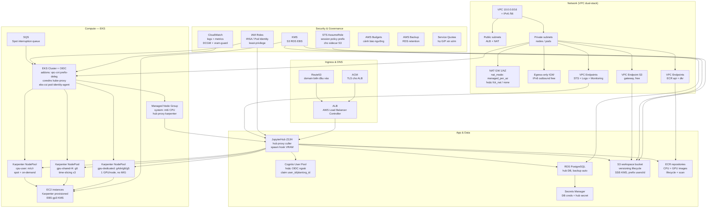

# AWS Resource Map — JupyterHub GPU Sandbox (EKS, ap-southeast-2)

> Nguồn: mục 4 doc handoff + scaffold `terraform/` hiện tại.
> Mũi tên `-->` = phụ thuộc / gọi tới. Nhóm `[...]` = service lẻ tham gia.

## Bảng service lẻ (checklist xin quota / bật)

| Nhóm | Service | Dùng cho | Ghi chú chi phí Sydney |
|---|---|---|---|
| Network | VPC, Subnets, IGW, Egress-only IGW | dual-stack outbound-only | free |
| Network | NAT Gateway (1/AZ) / fck-nat / none | IPv4 outbound `nat_mode` | ~$43/NAT/tháng + $0.059/GB |
| Network | VPC Endpoints (S3 gw free; ECR/STS/Logs/Monitoring interface) | tránh phí NAT | ~$10/tháng/AZ/endpoint |
| DNS/TLS | Route53, ACM, ALB (LBC) | domain hub | ALB ~$25/tháng + LCU |
| Compute | EKS control plane | cluster | ~73 USD/tháng |
| Compute | EC2 g6.xlarge (L4) shared | time-slicing ×3 | theo giờ on-demand |
| Compute | EC2 g4dn/g6/g5.xlarge dedicated | 1 GPU/node | theo giờ on-demand |
| Compute | EC2 m6i (system + cpu-user) | hub + CPU profiles | rẻ, cpu-user có Spot |
| Compute | EBS gp3 (KMS) | node + ephemeral buffer | theo GB |
| Orchestr. | Karpenter + SQS interruption | autoscale NodePools | free (chỉ EC2 + SQS) |
| Registry | ECR | image CPU/GPU + scan | storage + API |
| Data | S3 workspace (versioning, lifecycle, SSE-KMS) | backup workspace + quota | storage + request |
| Data | RDS PostgreSQL + AWS Backup | hub DB | instance + storage + backup |
| Auth | Cognito (hoặc OIDC ngoài) | đăng nhập, claim plan | theo MAU |
| Sec | IAM (IRSA/Pod Identity), STS, Secrets Manager, KMS | cô lập prefix, creds ngắn hạn | SM ~$0.4/secret/tháng |
| Obs | CloudWatch, DCGM exporter, vram-guard metrics | Xid, VRAM/pod, kill events | logs + metrics |
| Gov | AWS Budgets, Tags, Service Quotas | chốt chặn chi phí GPU | free |
